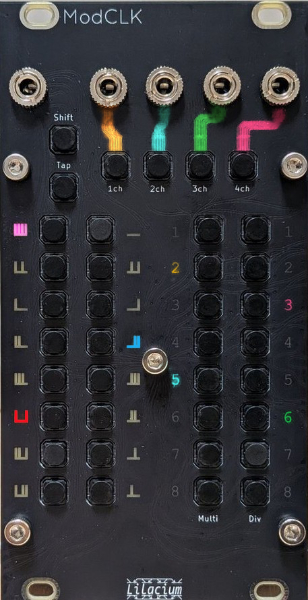
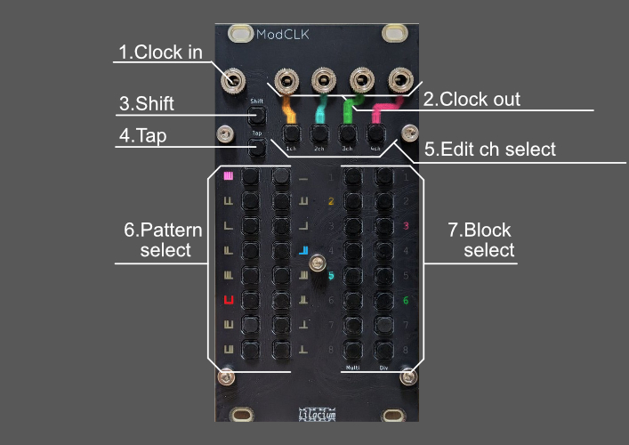
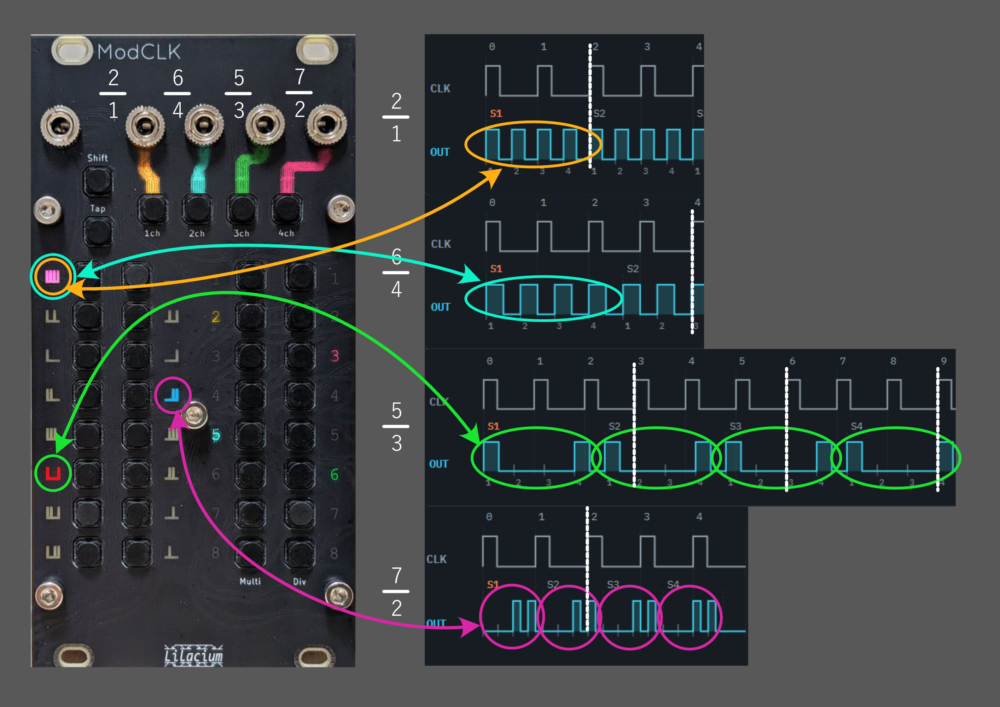
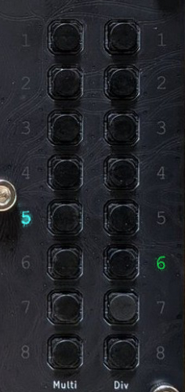
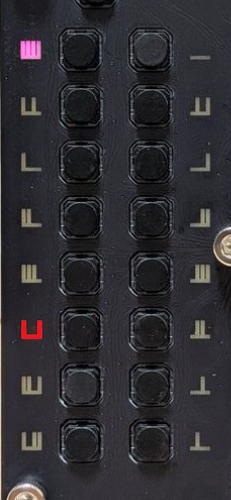
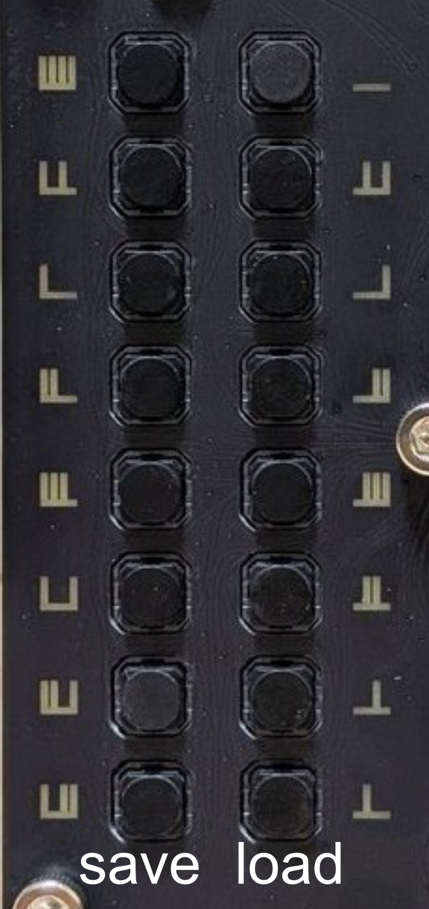

  
自由に分周比決めたいですよね？？？？？私は決めたい！！！！！！！  
ポリリズムしたい！！！！！！  
という事でモジュール作りました。

<iframe width="560" height="315" src="https://www.youtube.com/embed/E9-983L3lJ0" title="ModCLK" frameborder="0" allow="accelerometer; autoplay; clipboard-write; encrypted-media; gyroscope; picture-in-picture; web-share" allowfullscreen></iframe>

<h2 id="特徴">特徴</h2>

・4ch独立で分周比が設定可能。非整数倍も可(5/7倍等)。  
・4stepを1ブロックとして扱い、1ブロックごとに16種のGateパターンを割り当て可能。  
・ステップの途中で分周比を変えても他chとの同期は維持される。

<h2 id="フロントパネルの解説">フロントパネルの解説</h2>

1. **Clock in**  
   Clock信号入力  
   1クロック受けるごとに1ブロック進む仕様
2. **Clock out(1ch~4ch)**  
   Clock信号出力
3. **Shift**  
   分周比の変更、ステップリセット、各種設定、パターンのセーブロードに使用
4. **Tap**  
   外部クロック無しで動作させるためのボタン　　
   1タップ受けるごとに1ブロック進む仕様
5. **Edit ch select**  
   編集するチャンネルの選択  
   本体設定の項目選択
6. **Pattern select**  
   各ブロックのGateパターン選択  
   プリセットのセーブ、ロード
7. **Block select**  
   編集するブロックの選択  
   分周比の選択

## 出力Gateの例

  

    
  

  

  入力を分周、逓倍した後に16種のGateパターンを割り当てるので上記のような波形出力になります。

## 操作の詳細

- [チャンネルの逓倍・分周](#チャンネルの逓倍分周)
- [パターンを作る](#パターンを作る)
- [プリセット](#プリセット)
- [色のカスタマイズ](#色のカスタマイズ)
  
  
  

<h2 id="チャンネルの逓倍分周">チャンネルの逓倍・分周</h2>

「Edit ch select」で編集したいチャンネルを選択。  
　　　↓  
「Shift」を押しながら「Block select」のボタンを押す。  

右側の列は分母の値を、左側の列は分子の値を選択する。  
例えば5/6倍に設定された時は「5」と「6」が光ります。

<h2 id="パターンを作る">パターンを作る</h2>

「Edit ch select」で編集したいチャンネルを選択。  
　　　↓  
「Block select」で編集したいブロックを選択。  
　　　↓  
「Pattern select」でブロックのGateパターンを選択。  

1ブロックは4stepに分かれており、どこでGateを出すかを16種類から選びます。  
ボタンの横の印がそれぞれのGateパターンを表し、選択中のパターンが光ります。

<h2 id="プリセット">プリセットの保存、読み出し、初期化</h2>

Gateパターンと逓倍・分周を、最大8スロットまで保存できます。  
「Pattern select」行方向1~8スロットあり、左側がsave、右側がloadに割り当てられています。

・「Shift」を押しながら「Pattern select」の左の列（save）を押すと、その番号のスロットに保存。  

・「Shift」を押しながら右の列（load）を押すと、その番号スロットを読み出し。  

・「Shift」を押しながら右の列（load）を1秒長押しすると、編集中の内容が初期値に戻ります。  

保存されるのは4ch分のGateパターンと各チャンネルの逓倍・分周の設定です。  
「Shift」を押している間、現在読み込んでいるスロットが明るく光ります。  
初期化で消えるのは編集中の内容だけで、セーブすることでスロットの初期化が完了します。

## 色のカスタマイズ

LEDの色は3種類に分けて変更できます。いずれも「Shift」を押しながら「Edit ch select」のボタンで出入りします。  

・「Shift」＋「Edit ch select」の2ch  
　「Pattern select」と「Block select」の32個のボタンの背景色 

・「Shift」＋「Edit ch select」の3ch  
　選択中のGateパターンの色と、編集中の位置を示すカーソルの色 

・「Shift」＋「Edit ch select」の4ch  
　1ch〜4chそれぞれのチャンネル色  

色を設定する操作は下記の通り。  
RGBの値をそれぞれ8段階で選択して色を自由に設定可能。  
「Pattern select」の左の列が輝度、右の列がRed。  
「Block select」の左の列がBlue、右の列がGreen。  
一番上が0で、下に行くほど値が大きくなります。 

3chから入る「Gateパターン色とカーソル色」のみ操作方法が異なる。  
「Pattern select」の左の列1番目でGateパターン、2番目でカーソルを選んでから色をRGB値を選択。  
輝度は4段階。「Pattern select」の左の列、5~8番目のボタンから選択。

混ぜた後の色は「Edit ch select」のLEDで確認できます。  
モードを抜けた時点で本体に保存されます。

